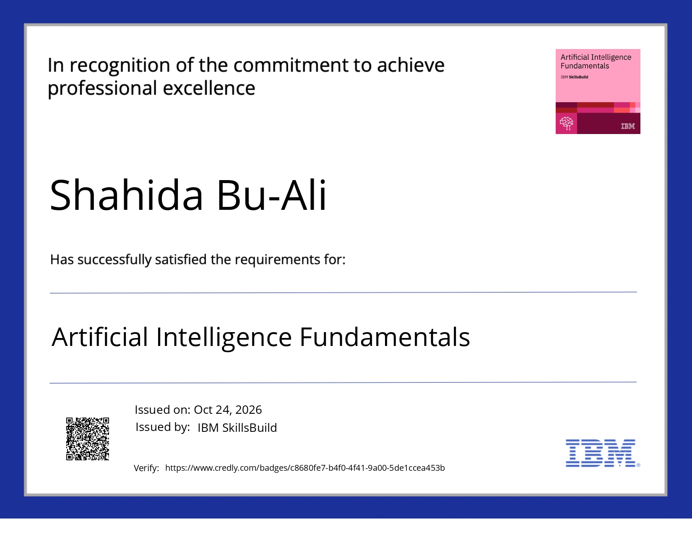

## 🌐 Socials:
   

# 💻 Tech Stack:
                    
# 📊 GitHub Stats:
 
 

---

<!-- Proudly created with GPRM ( https://gprm.itsvg.in ) -->
# Hey, I'm Shahida 👋

I'm a full-stack developer who enjoys building websites and web applications, working on the design, and figuring out how everything should work behind the scenes.

I like turning ideas into real projects and learning by building. Here are a few things I've worked on.

## 💻 My Projects

### 🛍️ Thread Co. | E-commerce Website

A clothing e-commerce project with a focus on the shopping experience and website design.

🔗 [Check out the website](https://thread-co-e-commerce-rose.vercel.app/)

### 🎀 My Personal Portfolio

My own portfolio website, where I share my work and experiment with design and website features.

🔗 [Visit my portfolio](https://shahidas-portfolio.vercel.app/)

### 🤖 AI Image-to-Captions

An AI-based project that generates captions from images. This is one of the projects I'm exploring as I work more with AI applications.

🔗 [Try the application](https://image-captioner-pi.vercel.app/)

### 💌 Rishta Elite | Matrimonial Platform

A matrimonial website built around helping people connect through an online platform.

🔗 [Visit Rishta Elite](https://rishta-elite.vercel.app/)

## 🎓 Certifications & Professional Learning

Here are some of the certifications and practical job simulations I've completed while expanding my knowledge of AI and Generative AI.

### 1. Artificial Intelligence Fundamentals | IBM

**Issuer:** IBM

🔗 [View verified credential on Credly](https://www.credly.com/badges/c8680fe7-b4f0-4f41-9a00-5de1ccea453b/public_url)

### 2. GEN AI Virtual Internship | BCG / Forage

**Issuer:** Boston Consulting Group (BCG) via Forage

🔗 [View completion certificate](https://www.theforage.com/completion-certificates/SKZxezskWgmFjRvj9/gabev3vXhuACr48eb_SKZxezskWgmFjRvj9_6ad37d5c370ca66eb279ac60_1792745602361_completion_certificate.pdf)

### 3. Generative AI | Forage

**Issuer:** Forage

🔗 [View completion certificate](https://www.theforage.com/completion-certificates/PSJm5xBFZtjjf9AnA/i2nMh36aEWT7awGCa_PSJm5xBFZtjjf9AnA_6ad37d5c370ca66eb279ac60_1792674136793_completion_certificate.pdf)

### 4. GenAI for Proposal Generation Job Simulation

**Issuer:** Please confirm from your certificate

🔗 [View certificate](PASTE_YOUR_CERTIFICATE_URL_HERE)

---

## 🛠️ Technologies I Work With

- **Frontend:** React.js, JavaScript, Redux, Tailwind CSS
- **Backend:** Node.js, Express.js, REST APIs, GraphQL
- **Databases:** MongoDB, PostgreSQL
- **Tools:** Git, Docker, AWS, Vercel

## 🌱 What I'm Working On

I'm continuing to improve my full-stack development skills and explore ways to bring AI features into useful web applications.

I also enjoy improving existing projects, solving bugs, and making websites easier to use.

## 🤝 Let's Connect

I'm open to remote development opportunities and freelance projects.

- 🌐 [Portfolio](https://shahidas-portfolio.vercel.app/)
- 💼 [LinkedIn](https://www.linkedin.com/in/shahida-bu-ali-3010ba288/)
- 🐙 [GitHub](https://github.com/shahidabuali)

Thanks for stopping by! 😊

<!--
**shahidabuali/shahidabuali** is a ✨ _special_ ✨ repository because its `README.md` (this file) appears on your GitHub profile.

Here are some ideas to get you started:

- 🔭 I’m currently working on ...
- 🌱 I’m currently learning ...
- 👯 I’m looking to collaborate on ...
- 🤔 I’m looking for help with ...
- 💬 Ask me about ...
- 📫 How to reach me: ...
- 😄 Pronouns: ...
- ⚡ Fun fact: ...
-->
